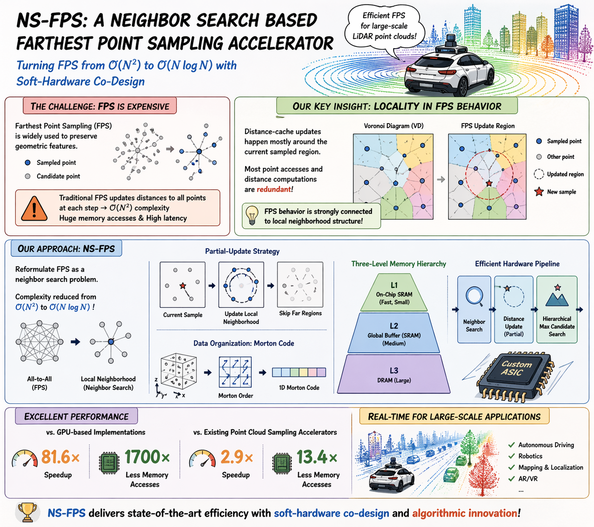

# 🚀 NS-FPS

<p align="center">
  
</p>

<div align="center">

**NS-FPS: Accelerating Farthest Point Sampling via Neighbor Search in Large-Scale Point Clouds [ISCA 2026]** 💎

[📄 Paper](figs/506501b211.pdf)

*Yuezu-fps: A high-performance and lossless Farthest Point Sampling (FPS) implementation based on Morton-coded neighbor search and multi-level caching, the CPU version of NS-FPS* ⚡

</div>

---

## ✨ Features

- 🌍 **Spatial Adaptivity**: Independent granularity configuration per dimension (e.g., X:32, Y:16, Z:8)
- 🌳 **Multi-Level Caching**: 16-1 tree structure for global farthest point query
- 🔁 **Incremental Update**: Only update affected spatial blocks instead of full traversal
- 🐍 **Python Binding**: Complete pybind11 interface with seamless NumPy integration
- 🏆 **Outstanding Performance**: Up to **191×** Faster than naive FPS on CPU, **1.72×** than SOTA QuickFPS-CPU, **4.2×** than naive FPS on GPU (under the best configuration)

---

## 🛠️ Installation

### 📋 Requirements

- 🐍 Python >= 3.7
- 🧮 NumPy
- 📦 pybind11
- 🔧 C++17 compiler (GCC >= 7 or Clang >= 5)

### 📥 Install from Source

```bash
git clone https://github.com/satreeby/ns-fps.git
cd ns-fps
pip install -e .
```

### ✅ Verify Installation

```bash
python -c "import yuezu_fps.yuezu_fps_module as yf; print(yf.DEFAULT_X_BLOCKS)"
```

---

## 🚀 Quick Start

```python
import numpy as np
import yuezu_fps.yuezu_fps_module as yf

# 📊 Generate point cloud
points = np.random.randn(10000, 3).astype(np.float32)

# 🎯 Create SpaceRange (manual range + granularity)
space_range = yf.make_range(
    min_x=-100, max_x=100,
    min_y=-100, max_y=100,
    min_z=-100, max_z=100,
    x_blocks=16, y_blocks=16, z_blocks=16
)

# ⚡ Execute FPS
indices = yf.fps(points, n_samples=1000, range=space_range)

# 🎉 Get sampled points
sampled_points = points[indices]
```

>You can also use `semantickitti_example.py` to verify the algorithm's performance on the real SemanticKITTI dataset. 📚

---

## 🔬 Core Concepts

### 📍 SpaceRange

Defines sampling space range and block granularity:

| Parameter            | Type   | Description                                       | Emoji |
| -------------------- | ------ | ------------------------------------------------- | ----- |
| `min_x`, `max_x` | float  | X-axis range                                      | 📏    |
| `min_y`, `max_y` | float  | Y-axis range                                      | 📏    |
| `min_z`, `max_z` | float  | Z-axis range                                      | 📏    |
| `x_blocks`         | uint32 | X-axis block count (power of 2, e.g., 8/16/32/64) | 🧱    |
| `y_blocks`         | uint32 | Y-axis block count (power of 2, e.g., 8/16/32/64) | 🧱    |
| `z_blocks`         | uint32 | Z-axis block count (power of 2, e.g., 8/16/32/64) | 🧱    |

### 🧮 Morton Encoding

Interleaves 3D block index (ix, iy, iz) into 1D code, preserving spatial locality. 🔄

- Total blocks = x_blocks × y_blocks × z_blocks
- Encoding bits = x_bits + y_bits + z_bits

---

## 📁 Complete Example

See `example.py` for comprehensive usage! 📘

---

## ⚙️ Configuration Macros (Compile-time)

| Macro                 | Default | Description                              | Tool |
| --------------------- | ------- | ---------------------------------------- | ---- |
| `MORTON_BLOCK_SIZE` | 16      | Points per leaf block (power of 2)       | ⚙️   |
| `CACHE_BLOCK_SIZE`  | 16      | Cache tree branching factor (power of 2) | 🌳   |
| `DEFAULT_X_BLOCKS`  | 16      | Default X granularity                    | 🧭   |
| `DEFAULT_Y_BLOCKS`  | 16      | Default Y granularity                    | 🧭   |
| `DEFAULT_Z_BLOCKS`  | 16      | Default Z granularity                    | 🧭   |
| `BOUNDARY_EPS`      | 1e-6f   | Boundary tolerance                       | 📏   |
| `INF_DISTANCE`      | 1e30f   | Initial infinity distance                | ∞    |

```bash
# 🛠️ Custom compilation
g++ -O3 -std=c++17 -DMORTON_BLOCK_SIZE=32 -DCACHE_BLOCK_SIZE=32 ...
```

---

## 🏗️ Project Structure

```
📦 yuezu_fps/
├── 📝 example.py
├── 📚 semantickitti_example.py
├── 🧪 test.py
├── 🔧 setup.py
├── 📖 README.md
├── 📊 eval/
├── 🐍 yuezu_fps/
│   └── 📄 yuezu_fps_pybind.cpp
└── 🧠 src/
    ├── 📄 yuezu_fps.h
    └── 📄 yuezu_fps.cpp
```

---

## 📜 Citation

If you use this code in your research, please cite our paper:
